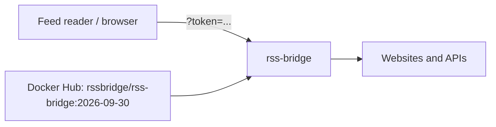

<div align="center">

# RSS-Bridge on Render

Generate RSS and Atom feeds for websites that don't have one. RSS-Bridge has hundreds of bridges for sites like YouTube, Telegram, Bandcamp, and Wikipedia, plus generic bridges that turn any page into a feed. This repo is the Blueprint. The app runs from the official [RSS-Bridge](https://github.com/rss-bridge/rss-bridge) image.

<p>
  <a href="https://render.com/deploy-template/api/github/start?template_repo=rss-bridge">
    
  </a>
</p>

<p>
  <a href="https://render.com">
    
  </a>
  <a href="https://github.com/rss-bridge/rss-bridge">
    
  </a>
  <a href="https://github.com/rss-bridge/rss-bridge/blob/master/UNLICENSE">
    
  </a>
</p>

</div>

## What This Template Shows

This repository does not contain the RSS-Bridge source. The service pulls the official image from Docker Hub at a pinned version. To upgrade, change the tag in [`render.yaml`](./render.yaml) and push.

| Piece | Role |
| --- | --- |
| **[RSS-Bridge](https://github.com/rss-bridge/rss-bridge)** | Fetches pages and APIs and turns them into feeds. |
| **`rss-bridge`** ([Web Service](https://render.com/docs/web-services)) | The app. No database or disk: it keeps only a short-lived feed cache. |

## Architecture



### How It Works

1. Click **Deploy to Render**. The flow copies this repo into your GitHub account and applies [`render.yaml`](./render.yaml).
2. Render generates `RSSBRIDGE_authentication_token`. There is nothing to fill in.
3. Open the service URL and enter the token.
4. Pick a bridge, fill in its form, and copy the feed URL into your reader. RSS-Bridge includes the token in the URL.

| Resource | Type | Plan | Notes |
| --- | --- | --- | --- |
| `rss-bridge` | Web, image | Starter | Port 80. No health check path, because every URL needs the token. |

Default region: **Oregon**.

### Why a token

A public RSS-Bridge fetches any page for anyone who asks, so open instances get used to scrape other sites through your server. The token makes every request carry a secret. Feed readers just use the URLs RSS-Bridge gives you.

## Quick Start

1. Click **Deploy to Render** above.
2. Wait until `rss-bridge` is **Live**.
3. Copy `RSSBRIDGE_authentication_token` from the service's **Environment** page.
4. Open the service URL and enter the token.
5. Generate a feed and add its URL to your feed reader.

## Sites that block cloud servers

Some sites rate-limit or block requests from cloud providers, including Render. In testing, the Reddit bridge returned `RateLimitException` (HTTP 429), and the GitHub Issues bridge returned an empty feed. Wikipedia and most sites with an RSS or JSON API worked. This depends on the site, not on Render or this template. If a bridge you need is blocked, set a proxy with `RSSBRIDGE_proxy_url` (see [`.env.example`](./.env.example)).

## Configuration

| Variable | Source | Description |
| --- | --- | --- |
| `RSSBRIDGE_authentication_token` | Generated | Required on every request. Rotating it breaks existing feed URLs. |
| `RSSBRIDGE_system_timezone` | Blueprint | `UTC`. |
| `RSSBRIDGE_<section>_<key>` | Optional | Any setting from [`config.default.ini.php`](https://github.com/rss-bridge/rss-bridge/blob/master/config.default.ini.php). For example, `RSSBRIDGE_system_enabled_bridges` limits the list of bridges. |

`generateValue` runs once, on the first Blueprint apply.

## Cost

Prices from [Render's pricing page](https://render.com/pricing).

| Resource | Approx. monthly |
| --- | ---: |
| `rss-bridge` (Starter) | $7 |
| **Total** | **~$7** |

RSS-Bridge used about 40 MB of memory in testing. The Free plan also works, but free services sleep after 15 minutes without traffic, and feed readers may time out while the service wakes up.

## Troubleshooting

| Problem | Solution |
| --- | --- |
| Every page asks for a token | Expected. Enter `RSSBRIDGE_authentication_token`. |
| A bridge shows `RateLimitException` or HTTP 429 | The site is blocking cloud servers. Retrying soon returns the cached error. See [Sites that block cloud servers](#sites-that-block-cloud-servers). |
| A feed is valid but empty | The site may serve cloud servers a different page. Try another bridge or a proxy. |
| Old feed URLs stopped working | The token changed. Copy fresh URLs from the front page. |

## Project Structure

```
render.yaml       Blueprint. One image-backed web service.
README.md         This file
LICENSE           Wrapper license
.env.example      Optional settings
```

## Learn More

- [Blueprint spec](https://render.com/docs/blueprint-spec)
- [RSS-Bridge docs](https://rss-bridge.github.io/rss-bridge/)
- [RSS-Bridge on GitHub](https://github.com/rss-bridge/rss-bridge)

## License

[MIT](LICENSE) for this wrapper. RSS-Bridge is released into the public domain under the [Unlicense](https://github.com/rss-bridge/rss-bridge/blob/master/UNLICENSE).
